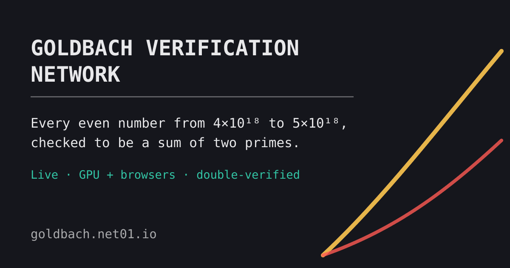

<p align="center">
  <a href="https://goldbach.net01.io"></a>
</p>

<h1 align="center">goldbach-web</h1>

<p align="center">
  <b>Help verify the Goldbach conjecture from a browser tab.</b><br>
  <a href="https://goldbach.net01.io">Live site</a> ·
  <a href="https://goldbach.net01.io/paper.html">Live paper</a> ·
  <a href="https://github.com/SINF-KEN/goldbach-l0-tidy">Native verifier</a>
</p>

<p align="center">
  
  
  
</p>

The dense Goldbach verifier of [goldbach-l0-tidy](https://github.com/SINF-KEN/goldbach-l0-tidy)
ported to **WebGPU + WebAssembly**, plus the coordinator that runs
**https://goldbach.net01.io**: browsers verify slices of [4·10¹⁸, 5·10¹⁸] from the
top down while the native B580 run works from the bottom up.

Results are exact and identical to the native `goldbach_l0` (primes and twins per
residue class, the p(n) tail histogram, first occurrences, max p(n), evens beyond
the candidate list): the tests below compare them on real windows.

## Layout

| Path | What |
|---|---|
| `core/core.cpp` | host mathematics (exact 64-bit), compiled to WASM with Emscripten; natively it is the test oracle |
| `shared/` | copies of `goldbach-l0-tidy`'s `src/primes.cpp` and `include/{config,primes,gstats}.hpp` (keep in sync) |
| `kernels/*.wgsl` | tile sieve, large primes, hit-list harvest, checker, prime/twin counts |
| `client/engine.js` | the pipeline on WebGPU (browsers and Node.js with Dawn), segments in flight |
| `client/worker.js` | leases slices and verifies them until Stop (self-test, retries, device recreation) |
| `client/pcache.js` | base primes generated once per device, then cached (OPFS; a file in Node.js), checksummed |
| `client/selftest.js` | known-answer self-test: a device that computes a wrong result never contributes |
| `client/index.html`, `app.js` | the dashboard (no frameworks, ~13 KB) |
| `server-rs/` | the Rust programs (no Python in the repository): `goldbach-server` (the coordinator: axum + SQLite), `goldbach-cpu-worker`, `goldbach-sync-native`, `goldbach-tools` (benchmarks, paper data, cross-check); see `server-rs/README.md` |
| `server/cpu_worker.cpp`, `goldbach-cpu-worker` | native single-core verifier (same results, byte for byte) and its service: the VPS verifies slices with spare CPU (`goldbach-cpu.service`, idle priority, 300 MB cap) |
| `server/auditor.mjs` | trusted re-verification of browser slices (refuses to run if its self-test fails) |
| `server/deploy.sh` | builds the Rust programs here and deploys to the VPS (the CPU verifier is built there) |
| `goldbach-sync-native` | pushes the B580 campaign summary to the server (user timer, every 10 min) |
| `test/` | correctness tests (below) |

## How it stays exact

* No 64-bit integers or float tricks on the GPU: large primes carry a u32
  first-multiple state across segments, hit-list primes a (segment, offset)
  state across batches; the host computes the initial states in exact u64.
* The checker tests candidates in ascending order, bit-parallel, so the first hit
  is p(n): the p(n) histogram is exact for every even, independent of the
  segment size (two devices with different settings produce identical results).
* Every even must be accounted exactly once per segment; overflows of any list,
  shader compilation errors and device error flags fail closed; leftovers are
  settled by deterministic Miller-Rabin in WASM.
* The server accepts a slice only when two different devices return the same
  sha256 of the canonical result (a third device settles a dispute).

## Build and test

The tooling is free software end to end: Node.js (MIT), Dawn (BSD-3), Mesa /
lavapipe (MIT), Emscripten (MIT / NCSA), Python, g++ (GPL); the repository and
the CI orchestration stay on GitHub. (Deno, used until 2026-10-09, gets only
fixes for a year after its team joined Cloudflare.) The test and tool scripts
are plain JavaScript modules (`test/*.mjs`, `server/auditor.mjs`) and need
Node.js 22 or newer; CI rejects TypeScript files.

```bash
bash core/build.sh            # client/core.js + core.wasm (needs Emscripten: ~/emsdk)
bash core/build.sh native     # build/core_native.so (oracle for the tests)
bash server/build_cpu.sh      # build/cpu_worker (native CPU verifier)
bash server-rs/build.sh test  # the Rust programs: coordinator logic, HTTP contract, CPU worker, sync (no GPU)
node test/pcache_test.mjs               # base-prime cache (no GPU)
node test/live_update_test.mjs          # page follows server updates (no GPU)
node test/worker_e2e.mjs 3              # the real worker against a local coordinator (leases, lease-ahead, uploads)
bash test/golden.sh cpu                # golden result hashes, CPU verifier (no GPU)
bash tools/ci_local.sh                 # everything the CI runs (WebGPU tests on lavapipe only)

# GPU tests: Node.js >= 22 with Dawn, Chrome's WebGPU
# (bash tools/setup_node.sh: npm package webgpu, pinned + integrity-checked, no npm
# needed); on the production machine pause production first
bash test/golden.sh gpu                                               # golden hashes, WebGPU engine
node test/tile_test.mjs                       # tile sieve vs reference
node test/map_test.mjs START LIMIT SEG K      # complete maps vs reference
node test/run_test.mjs START LIMIT [SEG] [K]  # statistics vs native goldbach_l0
node test/prof.mjs [START LIMIT SEG]          # GPU ms per pass (timestamps)
node test/timeline.mjs [START LIMIT]          # pipelined run: wall, busy time and gaps (SEQ= ablations)
bash tools/gpu_slot.sh CMD...                # run CMD on the production machine's GPU as the bench CI does
node test/contract_test.mjs                   # host/shader constants agree (no GPU)
```

Results are configuration-independent: `test/golden.sh` checks six windows
(full and phone mode, several segment sizes) against fixed hashes, on the GPU
engine and on the CPU verifier alike.

**AMD + Mesa RADV (Linux)**: some RDNA2 GPUs lose workgroup-memory atomics in
divergent loops (a driver bug, reproduced through Deno (wgpu) and
Chromium (Dawn)). The engine is exact on
correct drivers; the self-test keeps an affected device from contributing.

## How we work: branches, the benchmark CI, auto-merge

Every change is a branch. Pushing it is all it takes:

1. **CI** (`.github/workflows/ci.yml` -> `tools/ci_local.sh`, on the self-hosted
   runner below; no GitHub-hosted minutes): syntax, coordinator logic, WASM core,
   CPU verifier golden hashes, prime cache, live updates, WebGPU maps / modq /
   self-test on Mesa lavapipe (software Vulkan in `~/.local/share/lavapipe`;
   Dawn on the Vulkan backend only (never the OpenGL adapters of the real
   GPUs), and the script refuses to run unless the adapter
   is llvmpipe: never a real GPU). ~2-3 min: the golden CPU windows run in
   parallel, in the background of the other steps.
2. **Benchmark CI** (`.github/workflows/bench.yml` -> `tools/bench_ci.sh`, the
   self-hosted runner `computer-b580-web` on the Arc B580 machine):
   * candidate = the branch merged with the current main (exactly what would land);
   * pauses the native production campaign at a slice boundary and takes the shared
     GPU lock (`goldbach-l0-tidy/.goldbach-gpu.lock`); production resumes 2 minutes
     after the job unless another benchmark starts (queued branches share one pause);
   * exactness: the six golden result hashes (`test/golden.sh gpu`), modq vs BigInt,
     and identical results to main in every repetition; the base primes are
     generated once per job by the candidate's core and must match the known
     fingerprint (`test/primes.mjs`), every later run loads them in ~0.1 s;
   * cross-check: the candidate's WebGPU engine against main's CPU verifier (an
     independent implementation) on 12 random windows seeded by the commit (both
     modes, random segment sizes, single evens, the ends of the range, many
     segments; `goldbach-tools crosscheck`); one difference = not exact. A one-off
     campaign of 60 windows (2026-10-09): all identical;
   * a branch that changes no engine, kernel, core or CPU-verifier file is not
     benchmarked (no production pause; the PR stays open for review);
   * benchmark: main and candidate in one process (`test/bench_ab.mjs`), alternating
     whole windows in ABBA order, full and phone mode, 8 repetitions (8 more when
     borderline); GPU time per pass from
     timestamp queries, and slice wall time (setup + pipelined segments through
     `SliceRunner`, as the worker runs slices, scaled to a 1e12 slice: catches
     per-slice setup, uploads, gaps between submits and host work, which the pass
     sums cannot see; both sides verify the same windows); mean speedup with a 95 %
     confidence interval over ABBA pairs (`goldbach-tools bench-report`). The phone-mode
     pass sums are noisy (sd ~10 %); the slice wall time is steady (~0.3 %);
   * the report is posted as a comment on the branch's commit (and the job summary);
   * gating metrics: slice wall time (full, phone) and, when a branch touches it,
     the CPU verifier (`goldbach-tools bench-cpu`: znver3 build as on the VPS, 2e9
     segments, one pinned core); the GPU pass sums are per-pass diagnostics;
   * **exact and significantly faster** (95 % lower bound above +1 % in one gating
     metric, no significant regression in any; a `fix/*` branch, for correctness and
     fail-closed guards, only needs exact and no significant regression): pushed to
     main and deployed; open pages
     switch to it after their current slice. Otherwise it stays on the branch.

Never merge by hand what the benchmark CI rejected: results must stay exactly right,
speed only counts when it is measured.

## Live updates

The page arrives with its board and first chart data inline, then polls
`/api/live` every 30 s while visible (hidden: every 2 min while verifying, never
otherwise). Each poll names what the page already has (board hash, time of its
last poll, newest server slice), so an unchanged board or table is not sent
again and the charts get only the buckets that changed (~0.5 KB, ~2 KB when
the board changed). `/api/stats` (everything) and `/board` stay for scripts.

Static files are compressed once at start-up and kept in memory. A URL carrying
the file's current version (`app.js?v=<its hash>`, the engine files with
`?v=<engine hash>`) is cached for good; files no version depends on (icon, share
image, robots.txt, llms.txt, openapi.json, ...) for an hour; any other URL is
revalidated (304). The dashboard reads (`/`, `/board`, `/api/live`, ...) are kept
at the CDN for one snapshot period (15 s), may be served stale while it refetches
and for a day while the server is down, and carry an ETag of their body (304).
`node tools/page_traffic.mjs URL` measures the page's first-party traffic in
headless Chromium (cold, warm, open, hidden; `--worker` on SwiftShader only).

`/api/version` (also in every `/api/live` reply) publishes a hash of the engine
files and of the page. On a new engine the worker finishes its current slice
and a fresh worker on the new engine takes over (no reload); on a new page the
page reloads itself after the slice and resumes. The VPS CPU worker notices new
code on disk between slices and restarts itself on it (systemd), so a deploy
never throws away a slice in progress.

## Deploy

```bash
GB_DEPLOY_HOST=user@host bash server/deploy.sh   # key login
```

The service runs as `goldbach-web.service` (unprivileged user, read-only system,
listening on 172.18.0.1:8090 behind Traefik). Data: `/opt/goldbach/data`.

## Status

* Arc B580, per 1e12 slice including setup (benchmark CI under Deno, 2026-10-09;
  since the move to Node.js + Dawn the same engine measures ~20 % faster in full mode):
  full engine ~22.8 G evens/s (GPU passes ~8.1 ms per 467.5M segment: tile 1.6,
  large 2.2, check 3.8, harvest 0.5, counts 0.2), phone mode ~18.9 G evens/s.
  Since the morning of 2026-10-09 (21.5 / 16): writeBuffer uploads, the engine
  kept between slices, two segments per submit. Native goldbach_l0 on the same
  GPU: 67 G evens/s.
* Base primes: generated once per device (~5 s on a desktop), then loaded from
  the cache in ~0.1 s.
* The VPS (one EPYC Milan core) verifies ~0.07 G evens/s with the CPU verifier, ~2 h
  per slice, only with spare CPU. It always runs the best engine it has: at start
  and daily it times every candidate (portable / CPU-tuned build x segment size)
  on the known window and keeps the fastest exact one.
* History of this code: branch `web-port` of goldbach-l0-tidy.
